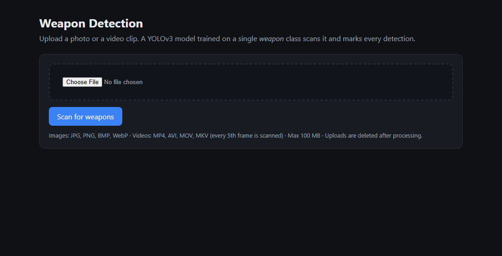

# Weapon Detection (YOLOv3)

A Flask web app and CLI that detect weapons in images, videos and live webcam feeds using a
single-class **YOLOv3** model run with OpenCV's DNN module on the CPU. Upload a file and you get
back annotated frames with confidence scores, timestamps for videos, and an audible alert
in the browser when a weapon is found.



## Features

- **Images and videos** through the web UI. Videos are sampled every 5th frame, and up to 12
  annotated hits are shown with their timestamps.
- **CLI** for images, video files or a **live webcam** feed (`detector.py`).
- **Class-aware confidence**: the score is objectness × class probability, followed by
  non-max suppression.
- **Secure uploads**: filenames are never trusted (random IDs on disk), there's a file-type
  allow-list, a 100 MB limit, and uploads are deleted after processing.
- **Browser-side alarm**: a generated beep plays only for the person viewing the results,
  never on the server.
- **Tests** cover the upload flow, a path-traversal attempt, file-type rejection, video
  sampling, the missing-weights error and the model config (with a stand-in detector).

## Model weights

The trained weights file (`yolov3_weapon.weights`, about 240 MB) is **not included** in
this repo because of its size. The app shows a clear message until it's in place. To get one:

1. Get a labelled weapon dataset in YOLO format, for example from
   [Roboflow Universe](https://universe.roboflow.com/search?q=weapon) or Open Images
   (class *Handgun* / *Rifle*).
2. Train with [Darknet](https://github.com/AlexeyAB/darknet), starting from `models/yolov3_weapon.cfg`
   (1 class, 416×416, `filters=18` before each `[yolo]` layer) and the `darknet53.conv.74`
   pretrained backbone. Google Colab's free GPU is enough for ~2,000 iterations.
3. Copy the resulting weights to `models/yolov3_weapon.weights`, or point to them with
   `WEAPON_WEIGHTS=/path/to/file.weights`.

## Run

```bash
pip install -r requirements.txt

# Web app → http://127.0.0.1:5000
python app.py

# CLI
python detector.py --image photo.jpg          # writes photo_detected.jpg
python detector.py --video clip.mp4           # live preview window, q to quit
python detector.py --webcam --conf 0.4

# Tests
python -m pytest
```

> `opencv-python` is pinned below 5.0 because OpenCV 5 removed the Darknet model importer.

## Project structure

```
├── app.py                 # Flask routes: upload → detect → results page
├── detector.py            # WeaponDetector (OpenCV DNN), annotate(), scan_video(), CLI
├── models/yolov3_weapon.cfg
├── templates/             # base, upload and results pages
├── static/                # uploads/ (temporary) and results/ (annotated frames)
└── tests/test_app.py
```

## Limitations

- YOLOv3 on CPU runs at roughly 2–5 FPS, so the web app samples video frames instead of
  processing every one.
- A single "weapon" class can confuse look-alikes (phones, tools). More training data and
  hard negatives help.
